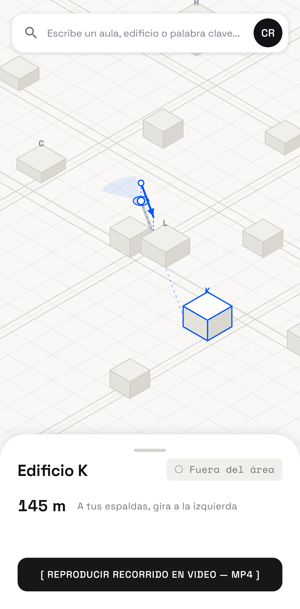
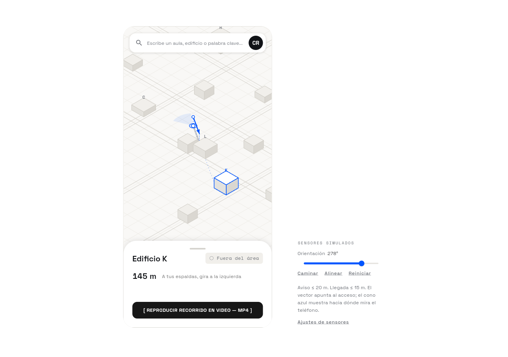
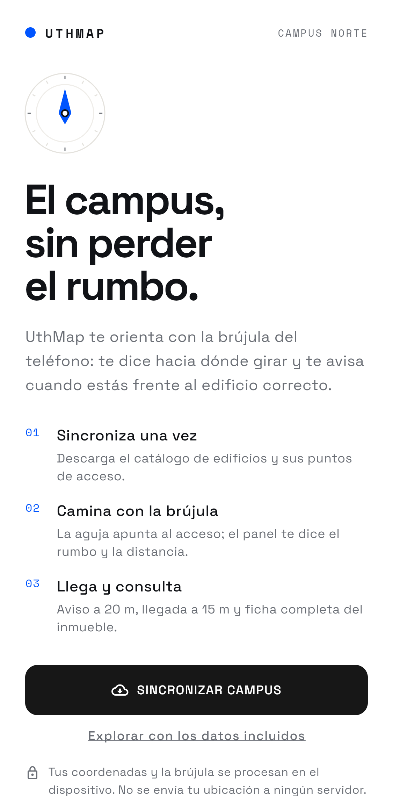

# UthMap

Prototipo **frontend puro en Flutter** para orientarse dentro de un campus con la
brújula del teléfono. Reproduce el wireframe definitivo (`375×760`, tema claro,
mapa isométrico) y cumple las reglas de geolocalización del enunciado.

| Móvil · 375×760 | Escritorio · stage + panel |
| --- | --- |
|  |  |

| Primera sincronización |
| --- |
|  |

## Qué hace

- **Navegación guiada (modo A):** elige un edificio y la aguja apunta al acceso
  más cercano. Muestra distancia, rumbo y una frase accionable
  («A tus espaldas, gira a la izquierda»).
- **Exploración libre (modo B):** sin destino, la app vigila el perímetro de los
  cinco edificios y avisa al entrar en el radio de cobertura (20 m por defecto,
  con histéresis de salida de +5 m).
- **Llegada:** a 15 m del acceso se detiene la caminata y se abre la ficha.
- **Directorio:** búsqueda por nombre, dependencia o etiqueta, insensible a
  mayúsculas y acentos, con filtros por categoría.
- **Ficha completa:** foto, descripción, dependencias, horario, etiquetas,
  coordenadas 1:N (entrada principal, secundaria y perímetro) y CTA de video.
- **Sincronización y offline:** la primera vez se sincroniza el catálogo
  (simulado desde `assets/data/edificios.json`); después se guarda en
  `shared_preferences` y la app arranca sin red.
- **Sensores:** simulación completa (slider de orientación, caminata, GPS
  denegado/apagado/sin señal, brújula sin calibrar) y conmutador a sensores
  reales con `geolocator` + `flutter_compass`.
- **Extras:** vista alternativa con teselas de OpenStreetMap y clips MP4 de dos
  inmuebles, ambos con atribución.

## Reglas implementadas

| Requisito | Implementación |
| --- | --- |
| Distancia geodésica | Haversine con `R = 6 371 000 m` (`lib/core/geo.dart`) |
| Rumbo inicial | `atan2` geodésico, normalizado a `[0, 360)` |
| Aguja | `(rumbo − heading) mod 360` |
| Cuadrantes | 315–45 / 45–135 / 135–225 / 225–315 |
| Aviso de proximidad | ≤ 20 m (radio por edificio) |
| Llegada | ≤ 15 m del acceso |
| Coordenadas 1:N | Entrada principal, secundaria y 4 vértices de perímetro |
| Filtro pasa-bajas | α = 0.15 con paso corto 359→0 |
| Geocerca | Entrada ≤ radio, salida > radio + 5 m |
| Modo por defecto | El wireframe abre en modo A con Edificio K; el modo B está a un toque en el menú del avatar |

## Requisitos previos

### Entorno general
- **Flutter SDK** (`3.47.3` o superior) y **Dart SDK** (`3.13.3` o superior).
- Habilitar *Native Assets* (requerido por las dependencias nativas del proyecto):
  ```bash
  flutter config --enable-native-assets
  ```

### Para compilar en Windows de escritorio
Si vas a ejecutar con `-d windows` (necesario por los paquetes nativos de `geolocator_windows`):
1. **Visual Studio 2022 / 2026** con la carga de trabajo **Desarrollo para el escritorio con C++** (incluyendo *Windows 10/11 SDK* y *Herramientas de CMake para Windows*).
2. **NuGet CLI (`nuget.exe`)** instalado y accesible en el `PATH` del sistema (o copiado directamente en `C:\Windows\System32`).

> **Nota:** Si no tienes Visual Studio o NuGet configurados, puedes ejecutar el proyecto directamente en navegador (`-d edge` o `-d chrome`) sin instalar herramientas de C++.

## Ejecutar

```bash
git clone <URL_DE_TU_REPO>
cd uthmap
flutter pub get
flutter run -d windows      # o: flutter run -d edge
```

*(La primera compilación en Windows puede tardar unos minutos mientras Visual Studio y NuGet descargan e indexan las dependencias de C++; las ejecuciones siguientes toman solo unos segundos).*

Para abrir directo en el mapa (sin pasar por la sincronización):

```bash
flutter run -d edge --dart-define=UTHMAP_DEMO=true
```

En web también puedes añadir `?demo=1` a la URL. Sin el parámetro se muestra la
pantalla de bienvenida y la sincronización simulada.

Pruebas y análisis:

```bash
flutter analyze
flutter test
flutter build web
```

## Estructura

```text
lib/
  app.dart                 arranque, sincronización y lifecycle
  main.dart
  core/geo.dart            Haversine, rumbo, aguja, cuadrantes, filtro
  core/geofence.dart       histéresis de la geocerca
  data/models.dart         edificio, coordenadas 1:N, búsqueda sin acentos
  data/catalog_repository.dart
  state/navigation_controller.dart
  ui/                      mapa isométrico, sheet, sensores, directorio, ficha
assets/
  data/edificios.json      5 edificios · 30 coordenadas
  fonts/                   Space Grotesk + Space Mono
  img/                     fotografías normalizadas 1280×720
  videos/                  clips demostrativos K y M
docs/CREDITOS.md
```

## Limitaciones conocidas

- El campus y sus coordenadas son ficticios; no corresponden a una universidad
  real. El origen está en `19.0, -98.2`.
- Solo K y M tienen video. En el resto el CTA se sustituye por
  «VER FICHA COMPLETA» o por el aviso de que no hay clip.
- `video_player` no reproduce MP4 en Windows de escritorio; se muestra la
  portada y el mensaje correspondiente. En Android, iOS, macOS y Web sí.
- La vista OSM necesita conexión; el mapa isométrico y el catálogo funcionan
  offline. La app nunca envía la ubicación a un servidor propio.
- Las fotos son de Wikimedia Commons y se usan como referencia visual; los
  créditos están en la app y en [`docs/CREDITOS.md`](docs/CREDITOS.md).
